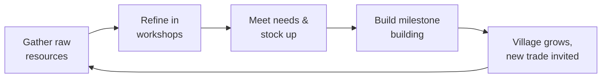
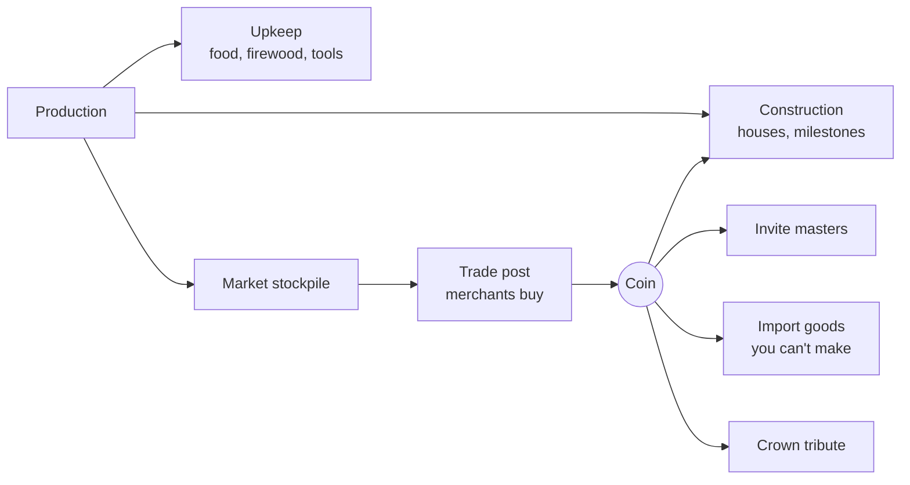

# Candlemarch — Design Spec v0.1

Last updated: 2026-09-23

A medieval-fantasy village builder where the fun is designing a settlement that runs itself. This is a living spec: it will change after every design round.

Tags used throughout:

- **Decided** — stated by the designer in the design rounds.
- **Proposed** — recommendation where the designer was unsure. Working default; may change.
- **v1 / v1.x / v2+** — which release a feature belongs to.

Title: Candlemarch. A march is a medieval borderland; candles are what keep the dark at bay.

## Vision

**Pitch:** Found a village in a wild fantasy valley. Gather what the land gives, invite master craftspeople to settle, and chain their trades into a self-running economy. Then keep it alive through winters, nights and whatever crawls out of the forest.

**Design pillars**

1. **The village runs itself.** Automation comes from good design: layout, roads, stock rules and supply chains. The player graduates from doing to directing. *(Decided: focus on automation.)*
2. **Every trade is earned.** A blacksmith or carpenter is a milestone, not a job slot. Masters arrive by invitation and have personalities. *(Decided)*
3. **The land pushes back.** Resources deplete and regrow, seasons change what works, nights are dangerous. *(Decided)*
4. **Cozy, with teeth.** Warm and charming, but villagers can starve, freeze or be killed, and the village can die. *(Decided)*

**Tone and references:** Graveyard Keeper's gloomy-cozy humour with a lighter dose of Don't Starve pressure. Mechanically: Factorio (production chains, automation), The Settlers (carriers and roads), Anno (needs tiers), Banished (survival and seasons), RimWorld-lite (named villagers).

## Core loops

The game runs on three nested loops, each feeding the next.

- **Minutes (moment to moment):** place buildings and roads, spot bottlenecks (idle workshops, overloaded carriers), fix them. Early on the hero gathers and hauls by hand.
- **A day and a season:** days bring work, nights bring monsters. Each season changes what produces and what is consumed; autumn is about stockpiling and preserving food for winter.
- **Hours (long term):** meet the conditions to invite the next master, pour resources and coin into a milestone building, rank the village up and unlock the next needs tier.

## World and map

Each game is a procedurally generated valley seeded with handcrafted points of interest. *(Decided: mix of procedural and handcrafted.)*

- **View:** isometric, square tile grid. *(Decided)*
- **Terrain:** meadow, forest, rock and mountain, river, swamp. Terrain gates expansion: a swamp needs draining, a snowed-in pass needs a road. *(Decided)*
- **Points of interest (handcrafted, placed by the generator):** ruins with loot, an abandoned mine, a roadside shrine, monster dens. *(Proposed)*
- **Resources deplete and regrow.** Forests and game recover slowly; ore and stone do not. *(Decided)*

**Forest ecology** *(Decided: logging and foraging compete; Proposed: the mechanics)*

- A forest tile is either **logged** or **foraged**, never both. Logging removes trees; foraging (berries, mushrooms) needs them standing.
- A **forester's lodge** replants trees in its radius. Young trees take about a year to mature.
- Game animals live in forest regions with a population that drops with hunting and recovers slowly. **Overhunting** empties a region for seasons.
- Result: the player sets aside forest reserves for food instead of clear-cutting.

## Time, day/night and seasons

One in-game year lasts about 60 minutes at 1× speed. *(Decided: roughly an hour; the split below is Proposed and tunable.)*

- **Controls:** real-time with pause and 1× / 2× / 3× speed. *(Decided)*
- **Day/night:** visible cycle, villagers go home and sleep at night. *(Decided)* Proposed length: 3 minutes per day (2 day, 1 night), 5 days per season.
- **Night** is when monsters spawn. *(Decided)*

| Season | Production | Consumption | Threat |
| --- | --- | --- | --- |
| Spring | Sowing; forest regrows fastest | Normal | Low |
| Summer | Harvest begins; berries peak | Normal | Bandits more active |
| Autumn | Main harvest; mushrooms peak | Stockpiling, preserving | Rising |
| Winter | Fields idle, river freezes (mill stops), no foraging | Every house burns firewood | Highest; longer nights |

*(Table is Proposed.)* Winter is the yearly exam: without enough preserved food and firewood, villagers freeze or starve.

## Resources and production chains (v1)

v1 has 10 raw resources and 12 refined goods across three tiers. *(Proposed; the categories and wild food are Decided.)* Buildings can offer several recipes where it makes sense. *(Decided)*

**Raw resources** — gathered by ordinary villagers, no master needed:

| Resource | Source | Building | Notes |
| --- | --- | --- | --- |
| Logs | Forest tiles | Woodcutter's hut | Removes trees |
| Berries, mushrooms | Standing forest | Forager's hut | Seasonal; spoil fast |
| Game meat, hides | Forest region | Hunter's lodge | Can be overhunted; hides are sold until the tannery arrives (v1.x) |
| Fish | River | Fisher's hut | Stops when river freezes |
| Stone | Rock | Quarry | Depletes |
| Clay | Riverbank | Clay pit | Depletes slowly |
| Iron ore | Mountain | Mine | Depletes |
| Grain | Field tiles | Farm | Idle in winter |

**Refined goods:**

| Tier | Output | Inputs | Building | Needs master |
| --- | --- | --- | --- | --- |
| 1 | Firewood | Logs | Woodcutter's hut | — |
| 1 | Charcoal | Logs | Charcoal kiln | — |
| 1 | Planks | Logs | Sawpit | Carpenter |
| 1 | Cut stone | Stone | Stonecutter | Mason |
| 1 | Bricks | Clay, firewood | Brick kiln | Mason |
| 1 | Smoked meat/fish | Meat or fish, firewood | Smokehouse | Butcher |
| 2 | Iron bars | Iron ore, charcoal | Bloomery | Smith |
| 2 | Flour | Grain | Windmill or watermill | Miller |
| 2 | Ale | Grain, firewood | Brewery | Brewer |
| 3 | Tools | Iron bars, planks | Smithy | Smith |
| 3 | Bread | Flour, firewood | Bakery | Baker |
| 3 | Furniture | Planks, iron bars | Carpenter's workshop | Carpenter |

**Spoilage** *(Decided: food spoils and preservation is its own tech)*

- Raw meat, fish, berries and mushrooms spoil in days; bread in about a season; smoked meat, grain and flour last much longer.
- A **root cellar** slows spoilage for food stored in it.

**Mills:** windmills and watermills are ordinary production buildings that must sit on a hill or river. There is no power network. *(Proposed, following the no-power rule.)*

## Logistics

Carriers walking on roads are the village's conveyor belts. *(Decided)* How belt-like they feel will be settled by prototyping both models below. *(Decided: prototype before choosing)*

| Model | How it works | Belt feel | Build cost | Risk |
| --- | --- | --- | --- | --- |
| A. Job dispatch (prototype 1) | A dispatcher assigns each haul (pick up at A, drop at B). Carriers path over roads, which make them faster. | Medium: traffic is visible, throughput limited by carrier count and distance | Low, well-understood | Bottlenecks are less legible |
| B. Flag relay (Settlers 2 style) (prototype 2) | Roads are split into segments between flags; one carrier per segment hands goods on at each flag. | High: each segment is a belt with real throughput | Higher | Frustrating if road layout is unforgiving |

**Collisions:** villagers never block each other; they pass through. This is standard in the genre and removes merging and jam logic. A soft slowdown on crowded road tiles can come later if bottlenecks need to be more visible. *(Proposed)*

**Making bottlenecks readable** *(Proposed)*: icons over idle workshops ("waiting for charcoal"), a carrier-utilization meter, and a road heat-map overlay.

**Storage** *(Decided: a mix; details Proposed)*

- **Workshop buffers:** each workshop holds a few units of inputs and outputs.
- **Stockpile zones:** open-air areas for bulk raw goods (logs, stone, clay).
- **Food store (granary):** villagers eat from it. *(Decided)* The root cellar is its preserving upgrade.
- **Market stockpile:** goods set aside for sale. *(Decided)*
- **Standing orders:** "keep 50 planks, pause the sawpit above 100." These are the main automation tool.

**Logistics upgrades** *(Decided in principle; order Proposed)*

| Stage | Unlock | Effect | Release |
| --- | --- | --- | --- |
| 1 | Hero hand-carry | Starting state | v1 |
| 2 | Carriers on dirt paths | Automated hauling | v1 |
| 3 | Cobblestone roads | Faster walking | v1 |
| 4 | Handcarts | More per trip | v1 |
| 5 | Ox carts on set routes | Long-distance lines to outposts | v1.x |
| 6 | River barges | Bulk transport by river | v1.x |
| 7 | Magical porters (golems, enchanted carts) | Late-game automation | v2+ |

## Villagers, needs and population

Every villager is a named individual with a home, a job and needs. *(Decided)* Ordinary villagers do basic jobs (gathering, hauling, farming); trades need a master (next section).

**Needs tiers** *(Decided: needs exist and gate growth; tiers Proposed)*

A house's residents rise a tier when their needs are met, and the house upgrades with them.

| Tier | House | Needs | Release |
| --- | --- | --- | --- |
| Settlers | Hut | Food, shelter, warmth (firewood in winter) | v1 |
| Craftsfolk | Cottage | Two kinds of food, ale at a tavern, furniture | v1 |
| Burghers | Townhouse | Bread, chapel, market, safety (walls) | v1.x |

**Happiness** raises or lowers work speed. The tavern, for example, makes nearby villagers work a bit faster. *(Decided)* Long unhappiness makes villagers leave. *(Decided as an option)*

**Population** *(Proposed)*

- v1: growth by **immigration only**. Newcomers arrive when there is free housing, surplus food and good happiness.
- v2: families, births and aging.
- Villager-to-villager relationships (friendships, marriages) stay out of v1; they distract from management. A good home is what villagers care about. *(Decided)*

**Death** *(Decided)*: starvation, freezing (no shelter or warmth in winter) and monsters. A dead master is a serious loss.

**Graveyard** *(Proposed, v1 stretch)*: the dead must be buried. Unburied bodies lower happiness and raise disease risk. Cheap to build, and very on-tone.

## Trades and masters

A trade exists in the village only once its master has settled there. *(Decided: trades are earned; masters are characters.)* v1 has 7 masters: Carpenter, Mason, Butcher, Smith, Miller, Brewer, Baker. *(Proposed)*

**How a trade scales without apprentices** *(Proposed; apprentices are v2)*

- The master runs their own workshop with a speed bonus.
- Once the master lives in the village, you can build more workshops of that trade and staff them with ordinary villagers.
- If the master dies or leaves, those workshops slow to a crawl until a new master is invited. Masters stay precious.

**Ways to invite a master** *(Decided: conditions, with several types; types Proposed)*

| Type | How it works | Example |
| --- | --- | --- |
| Charter | Meet listed conditions, then pay a signing fee | Smith: iron ore supply, 15 residents, a tavern, 500 gold |
| Passing caravan | A travelling master stays a few days; win them over in time | Brewer visits in autumn, wants 50 grain and a cottage |
| Rescue | The hero finds the master at a point of interest | Mason trapped in the ruins by monsters |
| Recommendation | A happy master vouches for a friend | Happy Miller brings a Baker |

**Notice board** *(Decided)*: invitations and side quests are posted on a notice board building in the village. Charter conditions, caravan visits and rescue leads all appear there, alongside side quests that reward coin, goods or reputation.

**Personality** *(Decided: masters have personalities)* — each master has 1–2 traits drawn from a pool. Examples:

- *Drunkard:* works faster within reach of a tavern, slower without.
- *Proud:* quits if a second master of the same trade is invited.
- *Early riser:* works longer days, grumpy if housed near the tavern's noise.
- *Pious:* happiness boost from a nearby shrine or chapel.

**Adjacency rules** *(Decided: yes)* — buildings have likes and dislikes that affect nearby homes and workshops. The tannery and smokehouse smell; the bakery makes neighbours happier; the smithy is loud. Layout becomes a social puzzle, not only a logistics one.

**Fantasy races** *(Decided: optional)* — v1 masters are human. From v1.x a master can be a dwarf, elf or halfling, with a race bonus and extra needs (a dwarf smith wants ale and stone housing).

## Economy: goods, tools and coin

Every good ends up in one of three places: consumed by the village, built into the village, or sold for coin. Coin buys what the village can't make itself. *(Proposed)*

**Tools: used and sold** *(Proposed; undecided, revisit once the first chains are playable)*

- Gatherers and craftspeople need a tool to work at full speed (axe, pick, sickle, hammer). Without one they work at half speed, so there is no hard lock.
- Tools wear out after about a year of use. The metal chain therefore has permanent demand, not a one-off build.
- Surplus tools are one of the best-selling goods at the trade post.

**Coin sources** *(Proposed)*

- **Trade post:** merchants visit on a schedule and buy from the market stockpile. Prices drop when you flood a good, which rewards a varied economy. Higher village reputation means more frequent and richer merchants.
- **Taxes** from Craftsfolk and Burghers. *(v1.x)*

**Coin sinks** *(Proposed)*

- Master signing fees.
- Milestone buildings, which cost coin plus goods. *(Decided)* Example: a tavern for 10,000 gold, 1,000 wood and 100 iron bars. Real numbers will come from balance simulations.
- Imports: seeds, iron bars before you have a mine, goods you can't produce yet.
- **Crown tribute** *(leaning yes)*: the lord's tax collector demands a set sum each year. Paying keeps the charter safe; missing it brings penalties. A gentle, recurring pressure that gives surplus a purpose early on.
- Mercenaries in an emergency. *(v1.x)*

## Heroes

The player controls one hero, an RTS-style unit who kickstarts the village and then becomes a specialist. *(Decided)* The hero picked at game start shapes the run. *(Decided: multiple heroes)*

**What a hero does**

- Gathers and hauls by hand in the first days, before carriers exist.
- Gives a production bonus to buildings nearby or to one chain (an aura).
- Fights monsters and bandits, and leads the militia.
- Explores points of interest and rescues masters.

**Heroes in v1** *(Proposed: two, to prove the system; more in v1.x)*

| Hero | Strength | Bonus |
| --- | --- | --- |
| Ranger | Forest and scouting | Faster foraging and hunting nearby; slower game depletion; sees further at night |
| Smith-lord | Metal and building | Faster bloomery and smithy nearby; tools last longer |

Later candidates: Priest (happiness, healing), Merchant (better trade prices), Warden (defence).

**The hero can't die.** *(Decided)* When defeated, the hero is knocked out and recovers at the village hall after a while. *(Proposed)* This costs time and leaves the village exposed that night.

**Progression** *(Proposed)*: heroes gain a new perk at each village rank instead of grinding XP, keeping the focus on the village.

**Control** *(Decided)*: no WASD. The hero is selected and ordered with the mouse, RTS style. How the hero fits the automation loop will be playtested once logistics works.

## Threats and combat

Combat is light and automatic: the player positions and prepares, units fight on their own. *(Decided: light combat; auto-resolve Proposed)*

**Night monsters** *(Decided: they spawn at night)*

- Monsters come from **dens** in the wilds. Left alone, dens slowly multiply toward the village. *(Proposed)*
- The hero and militia can clear a den by day, which rewards loot and calms the area.
- **Light keeps them back** *(Proposed)*: torches and braziers burn firewood and reduce spawns near buildings. It's a Don't Starve nod, and another reason the wood chain matters.

**Defence** *(Decided)*

- **Militia:** a bell calls villagers to arms. They drop their jobs, so every fight costs production.
- **Hero:** the strongest single fighter.
- **Palisades** block paths; **watchtowers** spot and shoot.

**Bandits** *(Decided as a threat; Proposed for v1.x)*: daytime raids in summer that target the granary and market stockpile. Pushed to v1.x to keep v1 combat to one enemy type.

**Other pressures** *(Decided)*: winter cold, hunger, unhappiness and emigration.

## Progression

The village climbs four ranks; each rank-up is a milestone building you pour goods and coin into. *(Decided: milestone buildings as resource dumps; ranks Proposed)*

| Rank | Milestone building | Requires | Unlocks |
| --- | --- | --- | --- |
| Camp | — (start) | Hero + 5 settlers | Gathering, huts, carriers, stockpiles |
| Hamlet | Village hall | Logs, stone, 10 residents | Trade post; invitations for Carpenter, Mason, Butcher, Brewer, Smith |
| Village | Tavern | Coin, planks, iron bars, ale in stock, 25 residents | Craftsfolk tier; Miller and Baker invitations; cobblestone roads, handcarts |
| Town | Town charter (guildhall) | Coin, cut stone, bricks, tools, 50 residents, all tier-2 needs met | v1 "win" in sandbox; endless play continues |

Exact numbers come from balance simulation. The example tavern cost (10,000 gold, 1,000 wood, 100 iron bars) sets the scale.

**Game modes** *(Decided: campaign with missions, plus sandbox)*

- **Sandbox:** endless. Settings for map seed, hero, winter harshness and monster rate. Rank goals give structure but play never ends. *(Decided: endless sandbox)*
- **Campaign, chapter 1** *(Proposed for v1)*: five missions that double as the tutorial.
    1. Survive the first winter.
    2. Invite your first master.
    3. Clear the den in the old forest.
    4. Pay the crown's tribute.
    5. Earn the town charter.

## Failure states

The village can die, and the game ends when it does. *(Decided)*

- **Game over:** no living villagers remain (the hero alone can't sustain a village). *(Proposed trigger)*
- **Death spiral warnings** *(Proposed)*: clear alerts before it's too late, such as "8 days of food left, winter in 3 days" or "no firewood in 4 homes."
- **Soft losses along the way:** masters dying or leaving, villagers emigrating, the crown revoking privileges after missed tribute.
- In campaign missions, some objectives can also fail (e.g. the mission fails if a key master dies).

## Tech and art direction

Build a code-first TypeScript game, packaged for desktop, so Claude Code can work on every part of it. *(Proposed)*

**Stack** *(Proposed)*

| Layer | Choice | Why |
| --- | --- | --- |
| Language | TypeScript | Strongest language of the developer; fast to review generated code |
| Simulation | Headless, deterministic, fixed-tick ECS in a Web Worker | Easy saves, testable economy, balance runs without rendering |
| Rendering | PixiJS (WebGL/WebGPU) | Mature 2D sprite renderer, handles isometric maps |
| UI | React (or similar) over the canvas | Panels and menus in a familiar stack |
| Content | Typed data files for resources, recipes, buildings, masters, traits | Claude can add and balance content in bulk |
| Desktop and Steam | Electron (well-trodden Steamworks path) or Tauri (lighter) | Ship to Steam and itch.io |

**Why simulation and rendering are separated:** the same simulation code runs in the game, in automated tests and in balance scripts ("does a 20-person village survive winter 3?"). Claude Code can then test design changes without anyone playing.

**Input and saves** *(Decided)*: mouse and keyboard only. Free saving at any time, plus an autosave at the start of each day.

**Repository layout** *(Proposed)*: a pnpm monorepo, so the simulation/rendering split is enforced by package boundaries.

| Package | Contents | May import |
| --- | --- | --- |
| `packages/sim` | Game state, `step(state, commands)`, save format | `content` only; no DOM, no Pixi |
| `packages/content` | Typed data: resources, recipes, buildings | Nothing |
| `packages/client` | Vite, PixiJS v8, React UI, Web Worker hosting the sim | `sim`, `content` |
| `apps/desktop` | Electron wrapper for Steam | Later, not in milestone 0 |

**Simulation rules** *(Proposed)*

- Fixed tick rate of 20 ticks per second, independent of frame rate.
- A seeded random number generator; no `Math.random` or `Date.now` in the sim.
- State is plain, serializable data; a save is the serialized state.
- Quantities are integers.
- Small hand-rolled entity-component system; switch to a library only if performance demands it.
- Every sim feature ships with a headless test.

**Tooling** *(Proposed)*: strict TypeScript, Vitest, Biome.

**Art** *(Decided: polished, cartoony, a bit dark, aimed at adults; not strict pixel art)*

- **References** *(Decided)*: Don't Starve (ink outlines, muted palette, paper-cutout animation), Hollow Knight (hand-painted, moody), Graveyard Keeper (tone and density).
- **Style** *(Proposed)*: hand-drawn 2D with bold, slightly wobbly ink outlines and a desaturated earthy palette. At night, warm light sources (torches, windows, forges) pop against the dark, tying the look to the light-keeps-monsters-away mechanic.
- **Animation** *(Proposed)*: cutout (skeletal) animation, as in Don't Starve. Characters are split into parts and moved by a rig (Spine or similar; PixiJS supports Spine). One rig serves many villagers with swapped heads, clothes and tools, and animations are data Claude Code can script.
- **Base tile, explained**: the size in pixels of one ground tile at 100% zoom. Every sprite is drawn to that scale, so it fixes how detailed art can be. For painted art, draw at high resolution (e.g. 256×128 per tile) and let camera zoom scale it down. *(Proposed)*
- **Pipeline** *(Proposed)*: Claude Code draws placeholder art as SVG (ink outline plus flat fills), which suits this style far better than pixel art. It also builds the tooling: export, texture atlases, rig setup and a consistent lighting treatment.
- **Final art**: a commissioned artist, or image generation followed by cleanup. Polished hand-drawn art is the hardest part of this project to automate, so budget for an artist eventually.

## v1 scope

v1 is a complete, winnable loop from Camp to Town on one procedural valley, with one enemy type and two heroes.

| Area | In v1 | Held for later |
| --- | --- | --- |
| Map | Procedural valley, isometric square grid, 4–5 handcrafted POI types | Multiple biomes, outposts, bigger regions |
| Time | Day/night, 4 seasons, pause and 3 speeds | Weather events |
| Resources | 10 raw, 12 refined, spoilage, root cellar, forest ecology | Textiles, leather, luxury goods |
| Logistics | Carriers, dirt and cobblestone roads, handcarts, standing orders | Ox carts, barges, magical porters |
| People | Named villagers, 2 needs tiers, happiness, immigration, death | Burghers tier, families, births, relationships |
| Trades | 7 human masters, 4 invitation types, traits, adjacency | Apprentices, fantasy races, more masters |
| Economy | Trade post, coin, tools that wear out, imports, crown tribute | Taxes, mercenaries, dynamic markets |
| Heroes | Ranger and Smith-lord, perks per rank | More heroes, hero gear |
| Threats | Night monsters from dens, militia, palisades, watchtowers, torches | Bandits, sieges, bosses |
| Modes | Endless sandbox with rank goals, campaign chapter 1 (5 missions) | Further chapters, challenge maps |
| Platform | Desktop (Steam and itch.io) | Co-op or multiplayer |

## Expansion backlog

v1.x deepens the v1 loop; v2+ adds new layers. Order within each release is not yet prioritized.

| Feature | Release | Idea |
| --- | --- | --- |
| Bandits | v1.x | Summer daytime raids on food and market stock |
| Burghers tier | v1.x | Townhouses; bread, chapel, market, walls |
| Leather and textiles | v1.x | Tannery, sheep, wool, weaver, tailor; clothing as a need |
| Fantasy races | v1.x | Dwarf, elf, halfling masters with bonuses and extra needs |
| More heroes | v1.x | Priest, Merchant, Warden |
| Ox carts and barges | v1.x | Route-based transport to outposts and along rivers |
| Taxes and mercenaries | v1.x | Coin from higher tiers; hired defence |
| Weather events | v1.x | Storms, drought, harsh winters, plague |
| Festivals | v1.x | Seasonal events that spend goods for big happiness boosts |
| Apprentices | v2 | Villagers train into journeymen under a master |
| Families and births | v2 | Aging, children, generations |
| Villager relationships | v2 | Friendships, rivalries, marriages |
| Enchanting | v2 | Enchanted tools and goods as a production tier (no power grid) |
| Magical logistics | v2 | Golem porters, enchanted carts |
| Outposts and biomes | v2 | Satellite mining and logging camps; mountain, marsh, coast maps |
| Mod support | v2 | Content is already data files, so mods follow naturally (Steam Workshop) |
| Co-op or trade between players | v2+ | Multiplayer villages sharing a region |

## First build target

Milestone 0 is one resource gathered, carried and turned into a building. *(Decided)* Done when you can watch logs flow from the forest into a finished hut.

**Milestone 0 contents** *(Proposed)*

- A small isometric map with trees, with camera pan and zoom.
- A woodcutter chops trees into logs at a woodcutter's hut.
- The player places a construction site for a hut.
- A carrier hauls logs from the woodcutter's hut to the site; the hut completes when enough logs arrive.
- Pause and speed controls, save and load.
- A headless test proves the simulation builds the hut within a set number of ticks.

**After milestone 0** *(Proposed order)*

1. Logistics prototypes A and B, then pick one.
2. Hero playtesting on top of the chosen logistics.
3. Map-size prototype.

## Open questions

These stay open until prototypes and playtests answer them. Everything tagged Proposed above is the working default until then.

- [x] Title: Candlemarch (Lanternwood is taken on Steam)
- [ ] Logistics: model A or B? Decided by prototype.
- [ ] Economy: should tools wear out?
- [ ] Hero role in the automation loop? Decided by playtest.
- [ ] Map size? Decided by prototype.
- [ ] Art: confirm cutout animation and a 256×128 base tile.
- [x] Hero control: mouse, RTS style, no WASD.
- [x] Master invitations: notice board, which also hosts side quests.
- [x] Saves: free plus autosave each dawn.
- [x] Input: mouse and keyboard.
- [x] First build target: one resource gathered, hauled and built with.
