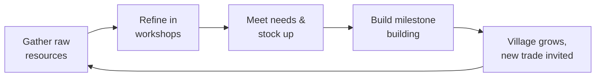
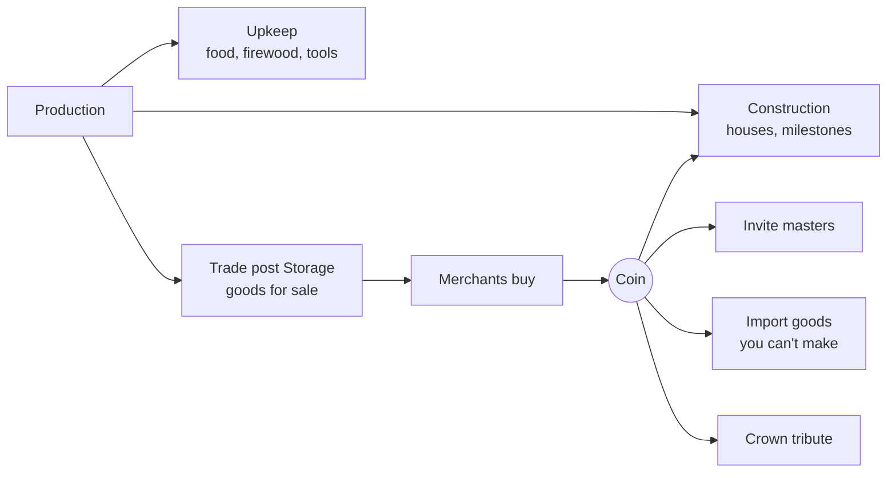

# Candlemarch — Design Spec v0.1

Last updated: 2026-10-01

A medieval-fantasy village builder where the fun is designing a settlement that runs itself. This is a living spec: it will change after every design round.

Tags used throughout:

- **Decided** — stated by the designer in the design rounds.
- **Proposed** — recommendation where the designer was unsure. Working default; may change.
- **v1 / v1.x / v2+** — which release a feature belongs to.

Title: Candlemarch. A march is a medieval borderland; candles are what keep the dark at bay.

## Vision

**Pitch:** Found a village in a wild fantasy valley. Gather what the land gives, invite master craftspeople to settle, and chain their trades into a self-running economy. Then keep it alive through winters, nights and whatever crawls out of the forest.

**Design pillars**

1. **The village runs itself.** Automation comes from good design: layout, roads, stock rules and supply chains. The player graduates from doing to directing. *(Decided: focus on automation.)*
2. **Every trade is earned.** A blacksmith or carpenter is a milestone, not a job slot. Masters arrive by invitation and have personalities. *(Decided)*
3. **The land pushes back.** Resources deplete and regrow, seasons change what works, nights are dangerous. *(Decided)*
4. **Cozy, with teeth.** Warm and charming, but villagers can starve, freeze or be killed, and the village can die. *(Decided)*

**Tone and references:** Graveyard Keeper's gloomy-cozy humour with a lighter dose of Don't Starve pressure. Mechanically: Factorio (production chains, automation), The Settlers (carriers and roads), Anno (needs tiers), Banished (survival and seasons), RimWorld-lite (named villagers).

## Core loops

The game runs on three nested loops, each feeding the next.

- **Minutes (moment to moment):** place buildings and roads, spot bottlenecks (idle workshops, overloaded carriers), fix them. Early on the hero gathers and hauls by hand.
- **A day and a season:** days bring work, nights bring monsters. Each season changes what produces and what is consumed; autumn is about stockpiling and preserving food for winter.
- **Hours (long term):** meet the conditions to invite the next master, pour resources and coin into a milestone building, rank the village up and unlock the next needs tier.

## World and map

Each game is a procedurally generated valley seeded with handcrafted points of interest. *(Decided: mix of procedural and handcrafted.)*

- **View:** isometric, square tile grid. *(Decided)*
- **Size** *(Decided at the M4 gate, [ADR-0004](adr/0004-valley-size-and-budget.md))*: the Valley is 128 × 128 tiles. It's a content number, so the playtest can move it. Hand-made maps stay for tests and debugging.
- **Terrain gates expansion** *(Decided)*: a Swamp needs Draining, a snowed-in Pass needs a Pass road.
- **Resources deplete and regrow.** Forests and game recover slowly; stone and iron Deposits do not. *(Decided)* Clay Deposits, Swamps (bog iron) and Fields (fieldstones) renew a little each spring; see **Renewing what runs out**. *(Decided in design session M5-02)*
- **Rotating buildings:** a building is placed in one of four orientations: the layout it is designed with, then quarter turns clockwise (a south door faces west, north, then east). A turn swaps its width and height, and every placement rule (a fisher's hut's door on the riverbank, say) is checked on the turned layout, so a fisher's hut fits either bank of a river. `Q` and `E` turn the placement preview. *(Proposed)*

**Terrain** *(Decided in design session M4-03; numbers Proposed)*. Forest isn't a Terrain: it's tiles with standing trees, and a tile stops being Forest when its tree is felled. Trees and Forage patches stand on Meadow.

**Trees are walked through** *(Decided after the M4 playtest; speed Proposed)*: villagers, the Hero and Gloamlings cross a tree's tile at 50% speed, so a wood is a slow way through, not a wall. Nothing can be built, paved or piled on a tree. Forage patches and Deposits still block walking.

| Terrain | Walk | Build | Walking speed | Notes |
| --- | --- | --- | --- | --- |
| Meadow | yes | yes | 100% | Replaces "grass" |
| Rock | yes | only a quarry (M5) | 80% | At the foot of the Mountains; stone Deposits sit on it |
| Mountain | no | no | — | The Valley's rim; iron Deposits sit on its faces |
| Swamp | yes | not until Drained | 50% | Beside the river's slow bends |
| River | no | no | — | Freezes in winter but stays impassable |
| Ford | yes | no | 50% | A shallow stretch of River; Gloamlings wade it too |
| Pass snow | the Hero only, at 30% | no | — | Until a Pass road is built |

- **Drain:** laid over Swamp tiles the way a Road is laid, one construction site per tile (2 logs, 200 build ticks). When finished, the tile becomes Meadow for good.
- **Pass road:** laid through the Pass the way a Road is laid (6 logs, 600 build ticks per tile). A finished tile is open to everyone all year. Dirt paths can't be laid on Pass snow. Before the road, the Hero alone wades the snow, so the player can scout the Side valley, clear its Den and Search its POIs before paying for the road. The road is also what lets the Side valley's Gloamlings through.
- **Crossing the river:** Fords only, until **bridges** arrive as an upgrade in M6, next to cobblestone roads.

**The Valley** *(Decided in design session M4-03; numbers Proposed, for 128²)*

- **Shape:** a Mountain rim all around. One river crosses the Valley from edge to edge, off-centre, with 2–3 Fords. One entry, a gap in the rim on an edge, holds the entry tile where Newcomers arrive; it isn't a Pass. Forest grows in noise-shaped patches that thin toward their edges, open into clearings and throw out lone trees across the open Meadow (*Proposed*), Swamp lies beside the river's slow bends, and Rock outcrops sit at the foot of the Mountains.
- **Side valley:** a pocket behind the Pass through the rim. It holds both groups of iron Deposits, the Abandoned mine and at least one Den, so the Pass road is what opens M5's metal chain.
- **The Camp** (the Starting Camp: Granary, Stockpile, settlers and Hero) starts within 10 tiles of the entry. The generator guarantees near it:
    - 24 × 24 tiles of buildable Meadow at the Camp, with no Swamp. Trees stand scattered sparsely on it (they can be felled), but not in the Camp's yard: within 5 tiles of the Granary, where the Camp and the way in from the entry stay bare (*Proposed*);
    - at least 150 trees within 15 tiles, forming at least one Hunting ground;
    - at least 6 Forage patches within 20 tiles;
    - a Riverbank within 20 tiles and a Ford within 30;
    - a group of stone Deposits and a group of clay Deposits within 30 tiles;
    - no Den within 40 tiles.
- **Per Valley:** 3 Dens at the start (each at least 40 tiles from the Camp, at least one in the Side valley), 2 Ruins, 1 Shrine (on the way from the entry toward the Pass), 1 Abandoned mine (Side valley), 5 groups of stone Deposits, 4 of clay and 2 of iron, 2–4 Swamp patches.
- **Same seed, same Valley.** The generator uses only the seeded PRNG. If a guarantee fails, it retries with a seed derived from the first. The player doesn't choose where the Camp starts in v1 (see the backlog).

**Deposits** *(Decided in design session M4-03; groups and amounts decided in design session M5-02, numbers Proposed)*: map objects holding a fixed amount of stone (on Rock), clay (on a Riverbank) or iron ore (on a Mountain face). The M4 generator places them; M5 works them.

- **Groups:** Deposits come in groups of 3–20, scattered over a patch of their ground, never one solid clump, though a few may touch. A group's size is how rich the site is, and the player can see it at a glance.
- **Amount:** one Deposit lasts about 2 seasons of digging by one worker.
- **Running out:** dug-out stone and iron ore never come back. A clay Deposit regains ¼ of its starting amount at the start of each spring, up to that amount, even once dug out. An empty Deposit stays on the map, drawn dug out; nothing else happens to it.
- When the mountain runs dry, the village turns to bog iron, fieldstones, imports and (M6) scrap, deepened mines, salvage and bricks: see **Renewing what runs out**.

**Points of interest** *(Decided in design session M4-03; numbers Proposed)*: handcrafted stamps the generator places. What a POI holds is unknown until it's Searched.

- **Ruins:** the Hero **Searches** them by standing on the tile for 200 ticks by day. A searched Ruins leaves a Cache (M4: 15 firewood and 6 hides; M5 adds 50 coin and 2 tools; each ±30% from the PRNG) and can't be Searched again. Hook: Ruins can hold a trapped master (M6 rescue invitations).
- **Abandoned mine:** on a Mountain face in the Side valley, over a group of iron Deposits, with a Den at its mouth. In M5 a mine placed on it costs less.
- **Shrine:** no Den buds within 12 tiles of it. Hook for the Pious trait (M6). It gives no Light, since ADR-0003 keeps Light expensive.
- **Den:** M3's Den, placed by the generator.

**Fog** *(Decided in design session M4-03, [ADR-0005](adr/0005-fog-lives-in-the-sim.md); numbers Proposed)*

- A tile is unrevealed (black), **Revealed** (seen at least once: ground, trees and buildings drawn as last seen, dimmed, and nothing that moves), or **In sight** (live).
- Fog changes what the player knows and where they may build, never what the world does: Gloamlings, Dens and villagers act as if it weren't there.
    - Buildings, Roads, Drains, Pass roads and Reserves go only on Revealed tiles.
    - Dens and POIs show once their tile is Revealed, including Dens that bud in the dark. Gloamlings show only In sight.
    - The Hero can be ordered into Fog.
- **Sight** (Chebyshev tiles, day / night): Hero 8 / 4 (the Ranger's "sees further at night" hooks in here in M7); villager 4 / 2; finished building 3 / 1; watchtower with its Watchman 8 / 8; Light: its lit tiles at night.
- At the start, everything within 12 tiles of the Camp is Revealed, plus the entry.
- **Fog setting:** per game, in state, like the Monster rate. It's chosen at New game (dev panel for now) and changed mid-game by a dev command. Off means every tile is Revealed and In sight. Switching it back on keeps what's already Revealed. It defaults to on for generated Valleys and off for hand-made maps. M7 moves it into the sandbox settings.

**Forest ecology** *(Decided: logging and foraging compete; mechanics Decided in design session M4-03, numbers Proposed)*

- **Tree tools** *(Decided after the M4 playtest; dig time Proposed)*: the woodcutter's hut panel has the tools for the trees around it, each painted as a rectangle (free, instant, only on Revealed tiles) and taken off again by its Erase tool:
    - **Fell** marks trees. A woodcutter fells marked trees in its radius before any other; unmarked trees are still felled as before, unless in a Reserve. A tree in a Reserve can't be marked.
    - **Keep** paints a Reserve (below), taking any Fell marks off the trees in it.
    - **Dig stumps** marks Stumps. A woodcutter in reach digs a marked Stump out (100 ticks) for 1 log, brought to the hut like a felled log, leaving bare Meadow where nothing sprouts.
- **Reserve:** the player paints Forest tiles as a Reserve (the Keep tool), and woodcutters never fell there. Foragers, hunters and foresters still work in it. It's painted and erased like a Dirt path, free and instant. It doesn't block building (the tree still has to go first). The woodcutter's hut placement preview shows Reserve tiles in its radius. This is how "a forest tile is either logged or foraged, never both" works: foraging never harms trees, so foragers need no rule.
- **Forester's lodge:** plants Saplings on empty Meadow in its radius. A Sapling matures into a tree in about a year.
- **Stumps:** a felled tree leaves a Stump, which sprouts a Sapling after a year. A clear-cut therefore heals on the same ground in about two years, with no creep onto new land. A building or Road on the tile removes the Stump, and so does digging it out (Dig stumps). The forester is the fast way to grow Forest, and the only way to grow it somewhere new.
- A **Sapling** can't be felled and doesn't block walking. It counts as a standing tree (shade for Forage patches, a Hunting ground's ceiling, Forest) only once it matures.
- **Hunting grounds:** each is a connected stretch of Forest of at most 250 tiles. The generator splits bigger stretches and names each ground from a list. Max Game is 1 per 5 trees at the start (Proposed; 1 per 10 until the food-balance pass after the M4 playtest).
- **Recovery:** while 0 < Game < ceiling, a ground gains 1 animal every 2 days. A ground hunted to 0 stays empty for 2 full seasons, then 2 animals return. Maturing Saplings raise the ceiling again.
- **Choosing a ground** *(Decided after the M4 playtest)*: a hunter's lodge can be set to hunt one Hunting ground in its reach, so two lodges don't overhunt the same one. By default it hunts the nearest ground in reach with Game. A lodge whose grounds have no Game shows "No Game left to hunt".
- Result: the player sets aside forest reserves for food instead of clear-cutting.

**Before full ecology (M2)** *(Decided in design session M2-01; numbers Proposed)*. M4 adds regrowth and recovery on top of these rules.

- **Hunting grounds:** a Hunting ground is a region of forest (hand-drawn on M2 maps, generated in M4) holding a single **Game** count, e.g. 20. Its ceiling follows the forest: `max game × standing trees ÷ trees at the start`. Felling trees lowers the ceiling, and animals above it **flee** at once.
- **Hunt chance** = 50% × game ÷ max game, rolled with the seeded PRNG. A catch gives 4 meat and 1 hide and removes one animal; a miss comes back empty. Overhunting shows as more and more empty trips. Nothing recovers until M4, when game regrows toward the ceiling and foresters raise it.
- **Visible:** each ground is outlined with a health word and colour (Thriving / Thinning / Scarce / Empty) while it matters: while a hunter's lodge is selected (its grounds in reach) or a hunter's lodge or woodcutter's hut is being placed (every ground), or the ground itself is selected. *(Outlines on select decided after the M4 playtest: always-on outlines were intrusive.)* Selecting it or a hunter's lodge shows "Game 12 / 20 · 2 fled due to logging · catch chance 30%". A "fled" puff shows when felling drives game out, a "no catch" icon over a hunter back empty-handed, and the woodcutter's hut placement preview warns when its radius overlaps a Hunting ground.
- **Forage patches:** berry bushes and mushroom patches are their own map objects in the forest. Trees don't give food. A patch's stock refills at the start of its seasons (bushes: small in spring, large in summer; mushrooms: autumn; nothing in winter; Proposed: a bush 4 and 10, a mushroom patch 12). A forager fills a basket (Proposed: 3) at a patch before walking back, but only while a standing tree is within 2 tiles (shade). A patch without shade withers: drawn bare, with a "no shade" hint when selected. The forager gathers from the nearest patch in radius with stock left.
- **Fish** don't deplete; fishing stops while the river is frozen.

## Time, day/night and seasons

One in-game year lasts about 60 minutes at 1× speed. *(Decided: roughly an hour; the split below is Proposed and tunable.)*

- **Controls:** real-time with pause and 1× / 2× / 3× speed. *(Decided)*
- **Day/night:** visible cycle, villagers go home and sleep at night. *(Decided)* Proposed length: 3 minutes per day (2 day, 1 night), 5 days per season.
- **Night length is set per season** in content, and winter nights are longer (Proposed: 1.5 of the 3 minutes). *(Decided)* The day stays 3 minutes; longer nights mean less work time and more cold nights.
- A new game starts at **Dawn on spring day 1**.
- **Night** is when monsters spawn. *(Decided)*

| Season | Production | Consumption | Threat |
| --- | --- | --- | --- |
| Spring | Sowing; forest regrows fastest | Normal | Low |
| Summer | Harvest begins; berries peak | Normal | Bandits more active |
| Autumn | Main harvest; mushrooms peak | Stockpiling, preserving | Rising |
| Winter | Fields idle, river freezes (mill stops, no fishing), no foraging; hunting goes on | Every house burns firewood; food spoils slower in the cold | Highest; longer nights |

*(Table is Proposed.)* Winter is the yearly exam: without enough preserved food and firewood, villagers freeze or starve.

## Resources and production chains (v1)

v1 has about a dozen raw resources and a dozen refined goods across three tiers. *(Proposed; the categories and wild food are Decided.)* Buildings can offer several recipes where it makes sense. *(Decided)*

**Raw resources** — gathered by ordinary villagers, no master needed:

| Resource | Source | Building | Notes |
| --- | --- | --- | --- |
| Logs | Forest tiles | Woodcutter's hut | Removes trees |
| Berries, mushrooms | Forage patches (need standing trees nearby) | Forager's hut | Seasonal; spoil fast |
| Game meat, hides | Hunting ground | Hunter's lodge | Can be overhunted, and logging drives game away; hides only with tools (M5); sold until the tannery arrives (v1.x) |
| Fish | River | Fisher's hut | Stops when river freezes |
| Stone | Rock | Quarry | Depletes; also fieldstones from Fields |
| Clay | Riverbank | Clay pit | Refills a little each spring |
| Iron ore | Mountain | Mine | Depletes |
| Iron ore (bog iron) | Swamp | Bog-iron digger | Slow; refills each spring; lost when the Swamp is Drained |
| Grain | Fields | Farm | Food; no seeds needed; idle in winter |
| Turnips | Fields | Farm | Food; needs bought seeds once; keeps through winter |

**Refined goods:**

| Tier | Output | Inputs | Building | Needs master |
| --- | --- | --- | --- | --- |
| 1 | Firewood | Logs | Chopping block | — |
| 1 | Charcoal | Logs | Charcoal kiln | — |
| 1 | Planks | Logs | Sawpit | Carpenter |
| 1 | Cut stone | Stone | Stonecutter | Mason |
| 1 | Bricks | Clay, firewood | Brick kiln | Mason |
| 1 | Smoked meat/fish | Meat or fish, firewood | Smokehouse | Butcher |
| 2 | Iron bars | Iron ore, charcoal | Bloomery | Smith |
| 2 | Flour | Grain | Windmill or watermill | Miller |
| 2 | Ale | Grain, firewood | Brewery | Brewer |
| 3 | Tools | Iron bars, planks | Smithy | Smith |
| 3 | Bread | Flour, firewood | Bakery | Baker |
| 3 | Furniture | Planks, iron bars | Carpenter's workshop | Carpenter |

**Firewood** *(Decided: its own building; details Proposed)*: the woodcutter's hut only fells trees. A **Chopping block** (1×1, cheap in logs) employs one Woodsplitter and splits 1 log into 2 firewood. It pauses while the village holds at least a target amount of firewood (Stockpiles plus House buffers; content default, e.g. 40), so it doesn't turn every log into firewood. In M5 the target becomes the chopping block's standing order, editable like any other. Logs go to construction sites first, then workshop inputs, then Stockpiles.

**Farms and crops** *(Decided in design session M5-02; numbers Proposed)*

- **Fields** are Meadow tiles the player paints in a farm's radius, painted and erased like a Reserve. Farmers sow, tend and harvest them.
- **The year:** Fields are sown in spring, grow for about a season, and are harvested from late summer through autumn, one harvest per Field a year. Anything not harvested when winter starts is lost. Fields lie idle in winter.
- **Crops:** each farm grows one crop, chosen in its panel; a change applies at the next spring sowing. M5 has two:
    - **Grain** needs no seeds. It's Food (eaten as it is) and keeps long. It's also the brewery's input, and from M6 the mill's: bread gives more Meals per grain than eating it.
    - **Turnips** need seeds. Food, more per Field than grain, and they keep through winter. Nothing processes them in M5.
- **Seeds** are bought once at the trade post, and that crop is then known to every farm for good: the village keeps seed back from its harvests. More crops come with their chains (hops for better ale in M6, flax with textiles in v1.x).
- **Fieldstones:** at the start of each spring, about 1 in 4 Field tiles throws up a stone. Farmers clear it before sowing, and it leaves the farm as stone.

**Renewing what runs out** *(Decided in design session M5-02; numbers Proposed)*

Deposits are a windfall, not a foundation: the easy stone and ore carry the village from Camp to Village. A mature village runs on what grows back (forests, fields, the river, the swamps) and buys the rest with its surplus. That's what pillar 1 means in the long run: a village that only eats what renews.

- **Bog iron (M5):** every Swamp tile holds a little iron ore, which builds back up each spring to a cap. A **bog-iron digger** (no master, Hamlet) works the Swamp in its radius, slowly, for ordinary iron ore. Draining a tile loses its ore for good, so every Drain is a choice between land and iron, like the Reserve's choice between logs and food.
- **Fieldstones (M5):** see Farms and crops.
- **Clay refill (M5):** see Deposits.
- **Imports (M5):** stone, clay, iron ore, iron bars and tools are always on sale at the trade post at twice base price, so a dry Deposit is a cost, never a dead end.
- **Decided in principle, designed in M6:**
    - a **scrap smelter**: worn tools come back as scrap, and charcoal plus scrap gives iron bars;
    - **deepening a mine**: a dug-out mine can be deepened once, for planks and coin, for more ore;
    - **salvage**: demolishing a building returns part of its stone;
    - **bricks for stone**: some building costs accept bricks in place of stone.

**Bees and candles** *(Decided in design session M5-02 for v1, M6; designed in M6)*: an apiary on Meadow by a forest edge gives honey (Food) and beeswax; a chandler turns beeswax (and the Butcher's tallow) into candles, a valuable export and later a need. Mead comes in v1.x. A game called Candlemarch should have candles.

**Spoilage** *(Decided: food spoils and preservation is its own tech)*

- Raw meat, fish, berries and mushrooms spoil in days; bread in about a season; turnips over a winter; smoked meat, grain and flour last much longer.
- A **root cellar** slows spoilage for food stored in it.
- **Model** *(Decided, [ADR-0002](adr/0002-spoilage-daily-share.md))*: at each Dawn every stack of Food in a Granary or workplace buffer loses `ceil(amount × rate%)`. Food in someone's hands doesn't spoil. Rates are per Food in content (Proposed: berries and mushrooms 25%, fish and meat 15%, smoked goods about 3%).
- **Cold keeps food** *(Decided)*: in winter every rate is multiplied by a content percentage (Proposed 20%, so meat loses 3% a day). With winter hunting, this is how a Camp gets through its first winter before the Butcher's smokehouse (M5). There is no no-master drying rack; it would undercut the smokehouse.

**Mills:** windmills and watermills are ordinary production buildings that must sit on a hill or river. There is no power network. *(Proposed, following the no-power rule.)*

## Logistics

Carriers walking on roads are the village's conveyor belts. *(Decided)*

**Model: job dispatch** *(Decided, [ADR-0001](adr/0001-logistics-model.md))*. A dispatcher assigns each haul (pick up at A, drop at B) to an idle carrier. Carriers path over any walkable tiles and walk faster on roads; the dispatcher measures nearness by walking cost, so better roads draw traffic. Throughput is set by carrier count and distance.

Flag relay (Settlers 2 style: one carrier per road segment between flags, handing goods on at each flag) was prototyped against it and dropped: laying out flags was fiddly. What it would have given, bottlenecks visible on the road itself, now has to come from the readability tools below.

**Collisions:** villagers never block each other; they pass through. This is standard in the genre and removes merging and jam logic. A soft slowdown on crowded road tiles can come later if bottlenecks need to be more visible. *(Proposed)*

**Making bottlenecks readable** *(Proposed)*: icons over idle workshops ("waiting for charcoal", "output full", "no worker"), a carrier-utilization meter, and a road heat-map overlay. **Carrier utilization** is the share of Carriers holding a Haul, averaged over the last in-game day; **road traffic** is Carrier steps onto each Road tile over the same window. *(Decided in design session M2-01)*

**Construction** *(Decided for M2)*: no builder villagers. A site's build timer starts once every material has arrived and runs only by day. Builders come back only if a playtest asks for them.

**Where goods are kept** *(Decided: a mix; details Proposed)*

- **Workshop buffers:** each workshop holds a few units of inputs and outputs.
- **Workplace yards** *(Decided, owner)*: every Workplace with an output buffer has a yard, a 1×1 tile of the building beside its door, turning with it, where its workers put what they make. It's part of the footprint (nothing else is built there, and it blocks walking like the building); Carriers pick up at the door. A yard holds 10 in total, shared by all the building's outputs (a hunter's meat and hides together), and a catch, basket or batch goes in only if it fits whole. The Granary and Houses have none; a fisher's hut's yard must stand on land. It's drawn like a Stockpile tile with the goods piled on it.
- **Stockpile zones:** open-air areas for bulk raw goods (logs, stone, clay). Each tile holds 10 of one good. *(Proposed)*
- **Storage** *(Decided in design session M5-02)*: goods a building keeps inside it. It isn't drawn on the ground, and the building's panel lists all of it. The Granary's Food is its Storage, and so are the trade post's goods for sale.
- **Granary:** villagers eat from its Storage. *(Decided)* The root cellar is its preserving upgrade. Food never goes to a Stockpile.
- **Goods for sale** wait in the trade post's Storage (this replaces the earlier "market stockpile"; see Economy).
- **Standing orders** *(Decided in design session M5-02; defaults Proposed)*: the main automation tool. Each Workplace with outputs has one number: it pauses while the village holds at least N of its output, and resumes below N. "The village holds" counts everything stored (Stockpiles, yards, Storage and House buffers), not goods being carried. Each output has a default N in content; the chopping block's firewood target is this rule. A resume level below N can come after the playtest if buildings flicker on and off.
- **Helping carry** *(Decided in design session M5-02)*: a worker whose Workplace can't use them (paused by its standing order, its yard full, or waiting for inputs) takes Hauls as a Carrier, from their own yard first and then any. After each Haul they check whether their Workplace can use them again. Their Job doesn't change; the villager panel says "helping carry", and the building's "Output full" or "Waiting for X" icon still shows.

**Logistics upgrades** *(Decided in principle; order Proposed)*

| Stage | Unlock | Effect | Release |
| --- | --- | --- | --- |
| 1 | Hero hand-carry | Starting state | v1 |
| 2 | Carriers on dirt paths | Automated hauling | v1 |
| 3 | Cobblestone roads | Faster walking | v1 |
| 4 | Handcarts | More per trip | v1 |
| 5 | Ox carts on set routes | Long-distance lines to outposts | v1.x |
| 6 | River barges | Bulk transport by river | v1.x |
| 7 | Magical porters (golems, enchanted carts) | Late-game automation | v2+ |

## Villagers, needs and population

Every villager is a named individual with a home, a job and needs. *(Decided)* Ordinary villagers do basic jobs (gathering, hauling, farming); trades need a master (next section).

**Needs tiers** *(Decided: needs exist and gate growth; tiers Proposed)*

A house's residents rise a tier when their needs are met, and the house upgrades with them.

| Tier | House | Needs | Release |
| --- | --- | --- | --- |
| Settlers | Hut | Food, shelter, warmth (firewood in winter) | v1 |
| Craftsfolk | Cottage | Two kinds of food, ale at a tavern, furniture | v1 |
| Burghers | Townhouse | Bread, chapel, market, safety (walls) | v1.x |

**Daily life and survival** *(Decided in design session M2-01; every number is content and Proposed)*

- **Meals:** each villager eats one Meal a day, at Dusk, on the way home: 1 unit of Food at the nearest Granary that has some, fastest-spoiling Food first (ties by resource ID). No delivery to houses. Food variety doesn't matter until Craftsfolk. A villager who finds no food goes home hungry.
- **Homes:** a Hut holds 3. A Homeless villager is given a free place automatically, in the House nearest their Workplace by walking cost (Carriers: nearest to where they stand), villagers in ID order. Nobody is moved once housed, and there's no manual assignment yet. A demolished House makes its residents Homeless. Homeless villagers sleep in the open where they stand.
- **Dusk:** no new work or Haul starts. A Carrier holding goods finishes delivering them; one still walking to a pickup drops the Haul. A gatherer abandons a chop in progress and drops goods in hand at their Workplace. Then everyone eats, walks home and sleeps. At Dawn they walk to work. A villager who hasn't reached home by Dawn turns back to work. There's no rule that Houses must be near Workplaces; the morning commute costs daylight.
- **Tired:** a villager who slept less than half the night at Home (Homeless ones included) walks and works 50% slower until the next Dusk, with a "zzz" icon.
- **Hungry:** a villager who missed their last Meal walks and works 50% slower; the panel shows "2 days without food; dies after 3". After 3 missed Meals in a row they starve at that Dusk. One Meal resets the count.
- **Warmth:** in winter each occupied House burns 1 firewood per night, taken at Dusk (per House, not per resident). A House that can't pay is cold that night. Houses keep a firewood buffer of 5 and ask for firewood from the start of autumn to the end of winter.
- **Cold:** a winter night in a cold House or in the open makes a villager Cold: 50% slower, with an icon. After 2 cold nights in a row they freeze at Dawn. A warm night resets the count. Freezing is deliberately faster than starving.
- **Slowdowns don't stack:** only the worst of Tired, Hungry and Cold applies, and every icon shows. The hero's aura still multiplies on top.

**Happiness** raises or lowers work speed. The tavern, for example, makes nearby villagers work a bit faster. *(Decided)* Long unhappiness makes villagers leave. *(Decided as an option)*

**Happiness in M5** *(Decided in design session M5-03; numbers Proposed)*

- **Per villager:** each villager has a score from 0 to 100, starting at 50. Things about a House (its neighbours) feed each resident's score.
- **About the good life, not survival:** Hungry, Cold and Tired keep their own slowdowns and don't touch happiness, so nobody is punished twice.
- **Sources in M5:** Homeless −30; −10 for each death in the village in the last 3 days; adjacency (below). The tavern, food variety and furniture join in M6. Sources add up and the score is clamped to 0–100.
- **Bands:** Happy at 70 or above works 20% faster; Content (30–69) as normal; Unhappy below 30 works 20% slower. The band multiplies on top of the worst of Tired, Hungry and Cold, like the Hero's aura.
- **Leaving:** a villager Unhappy for 5 Dawns in a row leaves at that Dawn, except in winter (the roads are snowed in). A Master who leaves is a lost master.
- **Readable:** the villager panel lists each source with its value; a House's panel shows each resident's band.

**Adjacency in M5** *(Decided in design session M5-03; numbers Proposed)*

- A building's likes and dislikes reach 4 tiles (Chebyshev) from its footprint and touch the residents of Houses there. Workplaces aren't affected in M5.
- Each kind counts once: ten trees nearby give +10, and two smokehouses still −10.
- **Likes (+10):** a standing tree or Reserve, a Shrine, the brewery.
- **Dislikes (−10):** smoke from the smokehouse, charcoal kiln and brick kiln; noise from the bloomery and the quarry.
- **Preview:** while placing a building, a ± badge shows over every House it would touch; while placing a House, the preview shows what its neighbours would add up to.

**Population** *(Proposed)*

- v1: growth by **immigration only**. Newcomers arrive when there is free housing, surplus food and good happiness.
- **Immigration rule (M2)** *(Decided in design session M2-01; numbers Proposed)*: checked at each Dawn. One Newcomer arrives when there's at least one free place in a House, Food in Granaries is at least 2 Meals × (population + 1) (Proposed; 5 was out of reach while Food spoils), and it isn't winter (the roads are snowed in). Newcomers enter at the map's entry tile, walk to the House they're given and start as Carriers. From M5, no Newcomer comes while the villagers' average happiness is in the Unhappy band.
- v2: families, births and aging.
- Villager-to-villager relationships (friendships, marriages) stay out of v1; they distract from management. A good home is what villagers care about. *(Decided)*

**Death** *(Decided)*: starvation, freezing (no shelter or warmth in winter) and monsters. A dead master is a serious loss.

**Graveyard** *(Proposed, v1 stretch)*: the dead must be buried. Unburied bodies lower happiness and raise disease risk. Cheap to build, and very on-tone.

## Trades and masters

A trade exists in the village only once its master has settled there. *(Decided: trades are earned; masters are characters.)* v1 has 7 masters: Carpenter, Mason, Butcher, Smith, Miller, Brewer, Baker. *(Proposed)*

**What a master is** *(Decided in design session M5-01)*: an ordinary villager with a trade and (from M6) 1–2 traits, marked with an icon over their head and in panels. They live in an ordinary House, eat, sleep, freeze and die like anyone else. "Wants a better House" can come later as a trait or a happiness source.

**How a trade scales without apprentices** *(Decided in design session M5-01; numbers Proposed; apprentices are v2)*

- A trade's workshops can be built from Hamlet on, before its master comes, but stand idle until the master settles.
- The master works in a workshop of their trade (the first one built, if there are several) at +50% speed.
- More workshops of the trade, staffed by ordinary villagers, work at normal speed while the master lives in the village.
- If the master dies or leaves, every workshop of the trade slows to a crawl (25%) until a new master comes: the workers remember a little. Masters stay precious.
- A master leaves only by dying or through long unhappiness (see Happiness), and takes nothing with them. Traits such as Proud add reasons in M6.

**Ways to invite a master** *(Decided: conditions, with several types; types Proposed)*

| Type | How it works | Example |
| --- | --- | --- |
| Charter | A master posts an offer on the notice board; meet its conditions and pay their fee | "Smith looking for a village": a bloomery, a mine, a charcoal kiln, a free place in a House, 300 coin |
| Passing caravan | A travelling master stays a few days; win them over in time | Brewer visits in autumn, wants 50 grain and a cottage |
| Rescue | The hero finds the master at a point of interest | Mason trapped in the ruins by monsters |
| Recommendation | A happy master vouches for a friend | Happy Miller brings a Baker |

**Notice board** *(Decided)*: invitations and side quests are posted on a notice board building in the village. Charter conditions, caravan visits and rescue leads all appear there, alongside side quests that reward coin, goods or reputation. *(Decided in design session M5-01)* It's a cheap 1×1 building, one per village, unlocked at Hamlet.

**Charters in M5** *(Decided in design session M5-01; numbers Proposed)*

- From Hamlet, the notice board shows up to 2 Charters at a time: a named master of a trade the village doesn't have yet, offering to settle for a fee. Trades are drawn with the seeded PRNG; one master per trade in M5.
- An offer stays up for 10 days, then is withdrawn; another offer of that trade turns up later. From M6, offers also show the master's traits, so two Smiths can be told apart.
- When every condition holds, the player accepts, the fee leaves the Treasury, and the master arrives at the entry tile like a Newcomer and walks to their free place.
- Fees run 100–300 coin, the Smith's the dearest. Conditions: a free place in a House, plus the master's workshop and a building that supplies it:

| Master | Workshop | Supply |
| --- | --- | --- |
| Carpenter | sawpit | woodcutter's hut |
| Mason | stonecutter or brick kiln | quarry |
| Butcher | smokehouse | hunter's lodge or fisher's hut |
| Brewer | brewery | farm |
| Smith | bloomery | mine or bog-iron digger, and a charcoal kiln |

**Side quests in M5** *(Decided in design session M5-02; numbers Proposed)*: one-off **delivery orders** on the notice board, such as "30 smoked fish within 10 days for 200 coin". One is open at a time; a new one is posted a few days after the last closes. No recurring orders. Den bounties come in M6.

**Personality** *(Decided: masters have personalities)* — each master has 1–2 traits drawn from a pool. Examples:

- *Drunkard:* works faster within reach of a tavern, slower without.
- *Proud:* quits if a second master of the same trade is invited.
- *Early riser:* works longer days, grumpy if housed near the tavern's noise.
- *Pious:* happiness boost from a nearby shrine or chapel.

**Adjacency rules** *(Decided: yes)* — buildings have likes and dislikes that affect nearby homes and workshops. The tannery and smokehouse smell; the bakery makes neighbours happier; the smithy is loud. Layout becomes a social puzzle, not only a logistics one. M5's table and rules are under Villagers (Adjacency in M5).

**Fantasy races** *(Decided: optional)* — v1 masters are human. From v1.x a master can be a dwarf, elf or halfling, with a race bonus and extra needs (a dwarf smith wants ale and stone housing).

## Economy: goods, tools and coin

Every good ends up in one of three places: consumed by the village, built into the village, or sold for coin. Coin buys what the village can't make itself. *(Proposed)* Trade is part of the core loop, not a side feature: the trade post is where renewable surplus becomes what the Valley can't renew. *(Decided in design session M5-02)*

**Coin** *(Decided in design session M5-02; prices Proposed)*: the village's money is one Treasury total in state, shown on the HUD. It's never stored or hauled. Scale: a log is worth about 2 coin, planks 6, hides 8, ale 8, iron bars 15, tools 40; Charter fees 100–300; turnip seeds 60; the Tavern's coin cost about 2,000. Refined goods are worth about 3× their inputs, so refining before selling pays. The balance harness tunes every number.

**Tools: used and sold** *(Proposed; the wear question stays open until after the M5 playtest. Shape decided in design session M5-02)*

- Tools are one good. A Workplace asks for one tool per worker; Carriers deliver it like an input.
- A worker with a tool works 50% faster (each chop, catch or batch); walking is unchanged. Without one, they work as they always have, so nothing built before Hamlet changes. *(Changed from "half speed without a tool", which would have slowed every Camp, since tools come only from imports until the M6 smithy.)*
- Some outputs need tools, set per output in content. In M5 that's only hides: hunters without tools bring meat alone.
- A tool wears out after about a year of days worked. In M5 a worn tool is gone; from M6 it comes back as scrap for the scrap smelter.
- Surplus tools are one of the best-selling goods at the trade post.

**Coin sources** *(Proposed)*

- **Trade post:** merchants visit on a schedule and buy from the trade post's Storage. Prices drop when you flood a good, which rewards a varied economy. Higher village reputation means more frequent and richer merchants (M6).

**The trade post in M5** *(Decided in design session M5-02; numbers Proposed)*

- Unlocked at Hamlet. Goods for sale wait in its Storage, listed in its panel.
- **Selling:** every good the village produces can be sold. A rule per good at the trade post says "keep N in the village, sell the rest", and Carriers haul the surplus in. Nothing is sold without a rule.
- **Merchants:** one arrives every 3 days and stays for a day, buying everything in the Storage at current prices. None come in winter (the roads are snowed in), so autumn is the big selling season.
- **Wanted list:** each merchant brings 2–3 goods they pay 50% more for, announced when the previous merchant leaves, so the village can prepare.
- **Prices:** each good has a base price. Each unit sold lowers that good's price by an amount set per good (cheap bulk goods fall slower per unit), down to 30% of base; it recovers 10% of base per day.
- **Imports:** ordered at the trade post at twice base price and brought by the next merchant into its Storage. The M5 catalogue: stone, clay, iron ore, iron bars, tools, grain, and turnip seeds. Goods the village should make (planks, ale) are left out on purpose.
- **Reputation** comes in M6.
- **Taxes** from Craftsfolk and Burghers. *(v1.x)*

**Coin sinks** *(Proposed)*

- Master signing fees.
- Milestone buildings, which cost coin plus goods. *(Decided)* They're built like any building; the coin is part of the construction cost. Example: a tavern for about 2,000 coin plus planks, iron bars and ale. Real numbers will come from balance simulations.
- Imports: seeds, stone and ore once the Deposits run dry, iron bars before you have a mine, tools before the smithy.
- **Crown tribute** *(leaning yes)*: the lord's tax collector demands a set sum each year. Paying keeps the charter safe; missing it brings penalties. A gentle, recurring pressure that gives surplus a purpose early on.
- Mercenaries in an emergency. *(v1.x)*

## Heroes

The player controls one hero, an RTS-style unit who kickstarts the village and then becomes a specialist. *(Decided)* The hero picked at game start shapes the run. *(Decided: multiple heroes)*

**What a hero does**

- Gathers and hauls by hand in the first days, before carriers exist.
- Gives a production bonus to buildings nearby or to one chain (an aura).
- Fights monsters and bandits, and leads the militia.
- Searches points of interest and rescues masters. It alone can wade a snowed-in Pass.

**Heroes in v1** *(Proposed: two, to prove the system; more in v1.x)*

| Hero | Strength | Bonus |
| --- | --- | --- |
| Ranger | Forest and scouting | Faster foraging and hunting nearby; slower game depletion; sees further at night |
| Smith-lord | Metal and building | Faster bloomery and smithy nearby; tools last longer |

Later candidates: Priest (happiness, healing), Merchant (better trade prices), Warden (defence).

**The hero has no needs** *(Decided)*: it doesn't eat, sleep or freeze, and can keep working at night.

**The hero can't die.** *(Decided)* When defeated, the hero is knocked out and recovers at the village hall after a while. *(Proposed)* Before a village hall exists, it recovers where it fell (see Nights in v1). This costs time and leaves the village exposed that night.

**Progression** *(Proposed)*: heroes gain a new perk at each village rank instead of grinding XP, keeping the focus on the village.

**Control** *(Decided)*: no WASD. The hero is selected and ordered with the mouse, RTS style. How the hero fits the automation loop will be playtested once logistics works.

## Threats and combat

Combat is light and automatic: the player positions and prepares, units fight on their own. *(Decided: light combat; auto-resolve Proposed)*

**Night monsters** *(Decided: they spawn at night)*

- Monsters come from **dens** in the wilds. Left alone, dens slowly multiply toward the village. *(Proposed)*
- The hero and militia can clear a den by day, which rewards loot and calms the area.
- **Light keeps them out** *(Decided in design session M3-01; see ADR-0003)*: torches and braziers burn firewood, and monsters never step onto a lit tile. It's a Don't Starve nod, and another reason the wood chain matters.

**Defence** *(Decided)*

- **Militia:** a bell calls villagers to arms. They drop their jobs, so every fight costs production.
- **Hero:** the strongest single fighter.
- **Palisades** block paths; **watchtowers** spot and shoot.

**Nights in v1 (M3)** *(Decided in design session M3-01; numbers Proposed and in content)*

- **Gloamling:** v1's one monster. Small, shadowy, many-eyed, comes in packs. 20 HP, 4 damage every 20 ticks at an adjacent tile, villager walking speed, sight 12 tiles.
- **Combat:** integer HP, damage per hit and a cooldown in ticks. A fighter hits its target when in reach and off cooldown. Within a tick, hits resolve in entity-ID order; targets are the nearest by walking distance, ties to the lowest ID. Villagers: 20 HP, 3 damage every 20 ticks, back to full HP at Dawn. A villager a Gloamling reaches fights back, militia or not.
- **Targets:** a Gloamling goes for the nearest villager out in the open (not asleep at Home), the Hero, or, with neither in sight, the nearest lived-in House. It batters the House's door (60 HP); when the door breaks, the residents asleep inside come out and fight it (and any other Gloamling that reaches them) until Dawn. *(Decided by the owner, replacing "kills one resident and moves on")* It picks again when its target dies, is Knocked out or steps into Light. Doors heal at Dawn, so nothing needs repairing. Watchtowers can't be attacked.
- **Dens:** a map object. At each Dusk a Den spawns Gloamlings on its tile: spring 1, summer 2, autumn 3, winter 4. Once a season it **buds**: a new Den 6–10 tiles closer to the nearest building, on a dark tile at least 12 tiles from any building and from any Shrine (M4), at most 5 Dens. Nothing can be built within 6 tiles of a Den, so it always keeps a dark ring. At Dawn every Gloamling still out vanishes.
- **Clearing a Den** (Hero only in M3; militia later): a Den has 80 HP and stings anything adjacent for 5 every 20 ticks. At 0 it's removed and leaves a cache of 4 hides and 6 firewood. No Den buds within 15 tiles of a cleared one for 10 days.
- **Light:** torch (1×1, 1 log, radius 2, 1 firewood a night, holds 3) and brazier (1×1, 4 logs, radius 4, 2 firewood a night, holds 6), Chebyshev radius. Each burns its night's firewood at Dusk; one that can't stays dark all night. Carriers fill them after Houses and before Stockpiles, and their firewood counts toward the chopping block's target. House windows give no Light.
- **Palisades:** segments laid like a Road (2 logs, 40 build ticks, 100 HP). A **Gate** (4 logs, 80 build ticks) lets villagers and the Hero through, but not Gloamlings. A Gloamling that can't reach its target batters the palisade in its way; damage heals at Dawn.
- **Watchtowers:** 1×1, 12 logs, staffed by one **Watchman** on a night shift: eats at Dusk, stands in the tower until Dawn, sleeps at Home by day (day sleep counts for Tired). Shoots Gloamlings within 6 tiles for 5 every 30 ticks, only while its Watchman is in it.
- **Militia bell:** 1×1, 5 logs, one per village. Ringing it (panel or HUD) calls every villager but Watchmen: they drop their work by the unassign rule and fight Gloamlings within 10 tiles of the bell. Ringing again, or Dawn, stands them down. A night at the bell is a night away from Home: Tired the next day, and Cold in winter.
- **Hero:** 55 HP, 9 damage every 20 ticks: it beats one Gloamling easily, two at once with real damage, and three at once knock it out; a healthy Hero clears a Den alone. Fights in reach on its own and can be ordered to attack. At 0 HP it's **Knocked out** where it falls for 400 ticks, ignored by Gloamlings, then gets up at full HP. The village hall (M5) becomes where it recovers.
- **Monster rate:** a per-game setting in state, chosen at New game (dev panel for now) and changeable mid-game by a dev command. It scales each Dusk's spawns (`trunc(n × rate ÷ 100)`). 0 is off: no spawns, no budding, and Gloamlings out vanish at once. M7 turns it into player-facing levels.
- **Pressure** grows through the seasons' spawn counts, longer winter nights and budding, not through a separate difficulty curve.

**Bandits** *(Decided as a threat; Proposed for v1.x)*: daytime raids in summer that target the Granary and the trade post's Storage. Pushed to v1.x to keep v1 combat to one enemy type.

**Other pressures** *(Decided)*: winter cold, hunger, unhappiness and emigration.

## Progression

The village climbs four ranks; each rank-up is a milestone building you pour goods and coin into. *(Decided: milestone buildings as resource dumps; ranks Proposed)*

| Rank | Milestone building | Requires | Unlocks |
| --- | --- | --- | --- |
| Camp | — (start) | Hero + 5 settlers | Gathering, huts, carriers, stockpiles; the quarry (the village hall needs stone) |
| Hamlet | Village hall | Logs, stone, 10 residents | Trade post, notice board; clay pit, mine, bog-iron digger, farm, charcoal kiln; every M5 master's workshop; Charters for Carpenter, Mason, Butcher, Brewer, Smith |
| Village | Tavern | Coin, planks, iron bars, ale in stock, 25 residents | Craftsfolk tier; Miller and Baker invitations; cobblestone roads, handcarts |
| Town | Town charter (guildhall) | Coin, cut stone, bricks, tools, 50 residents, all tier-2 needs met | v1 "win" in sandbox; endless play continues |

**Starting Camp** *(Decided in design session M2-01; amounts Proposed)*: a new game starts at Dawn on spring day 1 with a Granary holding 20 meat, a 2×2 Stockpile holding 30 logs, and 5 settlers (Carriers, all Homeless) plus the hero at the map's entry tile. No Houses or Workplaces. The first day's job is two Huts; anyone without a Home at Dusk is Tired on day 2.

**Rank requirements** *(Decided in design session M5-01)*: a rank building's resident requirement must hold before it can be placed (the build menu shows "needs 10 residents: 7/10"); its goods and coin are its construction cost, delivered and paid like any site's. Completing it raises the rank. The build menu shows only unlocked buildings; locked ones say what unlocks them.

Exact numbers come from balance simulation. The example tavern cost (about 2,000 coin plus planks, iron bars and ale) sets the scale.

**Game modes** *(Decided: campaign with missions, plus sandbox)*

- **Sandbox:** endless. Settings for map seed, hero, winter harshness and monster rate. Rank goals give structure but play never ends. *(Decided: endless sandbox)*
- **Campaign, chapter 1** *(Proposed for v1)*: five missions that double as the tutorial.
    1. Survive the first winter.
    2. Invite your first master.
    3. Clear the den in the old forest.
    4. Pay the crown's tribute.
    5. Earn the town charter.

## Failure states

The village can die, and the game ends when it does. *(Decided)*

- **Game over:** no living villagers remain (the hero alone can't sustain a village). *(Proposed trigger)*
- **Death spiral warnings** *(Proposed)*: clear alerts before it's too late, such as "8 days of food left, winter in 3 days" or "no firewood in 4 homes."
- **Alerts** *(Decided in design session M2-01; thresholds Proposed)*: worked out from the current state, not stored, listed in the HUD; clicking one moves the camera to it.
    - **Red**, someone dies at the next Dusk or Dawn: "Wynn will starve at dusk", "Oda will freeze at dawn".
    - **Amber**: "About N days of Food left" (Granary Food ÷ population under 3 days); in autumn, "Food for N days, winter in M days" (Food can't cover the rest of autumn plus winter); in autumn and winter, "N Houses have no firewood" (an occupied House's buffer is empty); in autumn, "Firewood for N nights, winter needs M" (stock below occupied Houses × winter nights); "N villagers Hungry / Cold / Homeless"; "Old Wood is Scarce" (a Hunting ground turns Scarce).
    - Food projections ignore Spoilage and say "about". Deaths go to a short message log ("Ada starved, day 14"), not the alert list. Through autumn the HUD shows "winter in N days".
- **Soft losses along the way:** masters dying or leaving, villagers emigrating, the crown revoking privileges after missed tribute.
- In campaign missions, some objectives can also fail (e.g. the mission fails if a key master dies).

## Tech and art direction

Build a code-first TypeScript game, packaged for desktop, so Claude Code can work on every part of it. *(Proposed)*

**Stack** *(Proposed)*

| Layer | Choice | Why |
| --- | --- | --- |
| Language | TypeScript | Strongest language of the developer; fast to review generated code |
| Simulation | Headless, deterministic, fixed-tick ECS in a Web Worker | Easy saves, testable economy, balance runs without rendering |
| Rendering | PixiJS (WebGL/WebGPU) | Mature 2D sprite renderer, handles isometric maps |
| UI | React (or similar) over the canvas | Panels and menus in a familiar stack |
| Content | Typed data files for resources, recipes, buildings, masters, traits | Claude can add and balance content in bulk |
| Desktop and Steam | Electron (well-trodden Steamworks path) or Tauri (lighter) | Ship to Steam and itch.io |

**Why simulation and rendering are separated:** the same simulation code runs in the game, in automated tests and in balance scripts ("does a 20-person village survive winter 3?"). Claude Code can then test design changes without anyone playing.

**Input and saves** *(Decided)*: mouse and keyboard only. Free saving at any time, plus an autosave at the start of each day.

**Repository layout** *(Proposed)*: a pnpm monorepo, so the simulation/rendering split is enforced by package boundaries.

| Package | Contents | May import |
| --- | --- | --- |
| `packages/sim` | Game state, `step(state, commands)`, save format | `content` only; no DOM, no Pixi |
| `packages/content` | Typed data: resources, recipes, buildings | Nothing |
| `packages/client` | Vite, PixiJS v8, React UI, Web Worker hosting the sim | `sim`, `content` |
| `apps/desktop` | Electron wrapper for Steam | Later, not in milestone 0 |

**Simulation rules** *(Proposed)*

- Fixed tick rate of 20 ticks per second, independent of frame rate.
- A seeded random number generator; no `Math.random` or `Date.now` in the sim.
- State is plain, serializable data; a save is the serialized state.
- Quantities are integers.
- Small hand-rolled entity-component system; switch to a library only if performance demands it.
- Every sim feature ships with a headless test.

**Tooling** *(Proposed)*: strict TypeScript, Vitest, Biome.

**Art** *(Decided: polished, cartoony, a bit dark, aimed at adults; not strict pixel art)*

- **References** *(Decided)*: Don't Starve (ink outlines, muted palette, paper-cutout animation), Hollow Knight (hand-painted, moody), Graveyard Keeper (tone and density).
- **Style** *(Proposed)*: hand-drawn 2D with bold, slightly wobbly ink outlines and a desaturated earthy palette. At night, warm light sources (torches, windows, forges) pop against the dark, tying the look to the light-keeps-monsters-away mechanic.
- **Animation** *(Proposed)*: cutout (skeletal) animation, as in Don't Starve. Characters are split into parts and moved by a rig (Spine or similar; PixiJS supports Spine). One rig serves many villagers with swapped heads, clothes and tools, and animations are data Claude Code can script.
- **Base tile, explained**: the size in pixels of one ground tile at 100% zoom. Every sprite is drawn to that scale, so it fixes how detailed art can be. For painted art, draw at high resolution (e.g. 256×128 per tile) and let camera zoom scale it down. *(Proposed)*
- **Pipeline** *(Proposed)*: Claude Code draws placeholder art as SVG (ink outline plus flat fills), which suits this style far better than pixel art. It also builds the tooling: export, texture atlases, rig setup and a consistent lighting treatment.
- **Final art**: a commissioned artist, or image generation followed by cleanup. Polished hand-drawn art is the hardest part of this project to automate, so budget for an artist eventually.

## v1 scope

v1 is a complete, winnable loop from Camp to Town on one procedural valley, with one enemy type and two heroes.

| Area | In v1 | Held for later |
| --- | --- | --- |
| Map | Procedural valley, isometric square grid, 4–5 handcrafted POI types | Multiple biomes, outposts, bigger regions |
| Time | Day/night, 4 seasons, pause and 3 speeds | Weather events |
| Resources | About a dozen raw and a dozen refined, spoilage, root cellar, forest ecology, renewable sources, bees and candles | Textiles, leather, mead |
| Logistics | Carriers, dirt and cobblestone roads, handcarts, standing orders | Ox carts, barges, magical porters |
| People | Named villagers, 2 needs tiers, happiness, immigration, death | Burghers tier, families, births, relationships |
| Trades | 7 human masters, 4 invitation types, traits, adjacency | Apprentices, fantasy races, more masters |
| Economy | Trade post, merchants with wanted lists, coin, tools that wear out, imports, seeds, crown tribute | Taxes, mercenaries |
| Heroes | Ranger and Smith-lord, perks per rank | More heroes, hero gear |
| Threats | Night monsters from dens, militia, palisades, watchtowers, torches | Bandits, sieges, bosses |
| Modes | Endless sandbox with rank goals, campaign chapter 1 (5 missions) | Further chapters, challenge maps |
| Platform | Desktop (Steam and itch.io) | Co-op or multiplayer |

## Expansion backlog

v1.x deepens the v1 loop; v2+ adds new layers. Order within each release is not yet prioritized.

| Feature | Release | Idea |
| --- | --- | --- |
| Bandits | v1.x | Summer daytime raids on the Granary and the trade post |
| Burghers tier | v1.x | Townhouses; bread, chapel, market, walls |
| Leather and textiles | v1.x | Tannery, sheep, wool, weaver, tailor; clothing as a need |
| Mead | v1.x | Honey from the M6 apiary brewed into a premium ale |
| Fantasy races | v1.x | Dwarf, elf, halfling masters with bonuses and extra needs |
| More heroes | v1.x | Priest, Merchant, Warden |
| Ox carts and barges | v1.x | Route-based transport to outposts and along rivers |
| Taxes and mercenaries | v1.x | Coin from higher tiers; hired defence |
| Weather events | v1.x | Storms, drought, harsh winters, plague |
| Festivals | v1.x | Seasonal events that spend goods for big happiness boosts |
| Kitchens and tavern meals | v1.x | Places to eat besides the Granary, serving cooked meals that give buffs instead of raw food |
| More House types | v1.x | A family house, a single room for loners who dislike company, larger shared houses |
| Choose a starting point | v1.x | The player picks where on the map the Camp starts |
| Apprentices | v2 | Villagers train into journeymen under a master |
| Families and births | v2 | Aging, children, generations |
| Villager relationships | v2 | Friendships, rivalries, marriages |
| Enchanting | v2 | Enchanted tools and goods as a production tier (no power grid) |
| Magical logistics | v2 | Golem porters, enchanted carts |
| Outposts and biomes | v2 | Satellite mining and logging camps; mountain, marsh, coast maps |
| Mod support | v2 | Content is already data files, so mods follow naturally (Steam Workshop) |
| Co-op or trade between players | v2+ | Multiplayer villages sharing a region |

## First build target

Milestone 0 is one resource gathered, carried and turned into a building. *(Decided)* Done when you can watch logs flow from the forest into a finished hut.

**Milestone 0 contents** *(Proposed)*

- A small isometric map with trees, with camera pan and zoom.
- A woodcutter chops trees into logs at a woodcutter's hut.
- The player places a construction site for a hut.
- A carrier hauls logs from the woodcutter's hut to the site; the hut completes when enough logs arrive.
- Pause and speed controls, save and load.
- A headless test proves the simulation builds the hut within a set number of ticks.

**After milestone 0** *(Proposed order)*

1. ~~Logistics prototypes A and B, then pick one.~~ Done: job dispatch (ADR-0001).
2. Hero playtesting on top of the chosen logistics.
3. ~~Map-size prototype.~~ Done: a 128² Valley (ADR-0004).

## Open questions

These stay open until prototypes and playtests answer them. Everything tagged Proposed above is the working default until then.

- [x] Title: Candlemarch (Lanternwood is taken on Steam)
- [x] Logistics: job dispatch (ADR-0001), after an A/B playtest against flag relay.
- [ ] Economy: should tools wear out?
- [ ] Hero role in the automation loop? Decided by playtest.
- [x] Map size: 128² with a performance budget (ADR-0004).
- [x] Deposits running out: renewable sources and imports (design session M5-02; Renewing what runs out).
- [ ] Art: confirm cutout animation and a 256×128 base tile.
- [x] Hero control: mouse, RTS style, no WASD.
- [x] Master invitations: notice board, which also hosts side quests.
- [x] Saves: free plus autosave each dawn.
- [x] Input: mouse and keyboard.
- [x] First build target: one resource gathered, hauled and built with.
